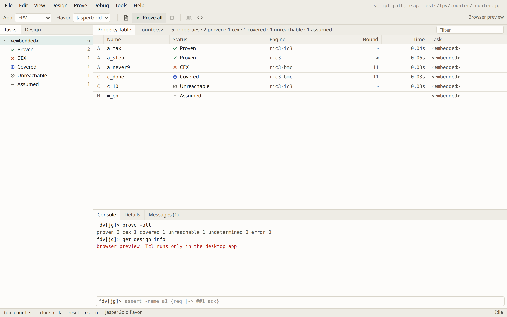

# InFormal

InFormal is an open-source formal verification tool for digital designs. It compiles SystemVerilog and IEEE 1800 SVA through [svlang](https://github.com/mayurkubavat/svlang), runs a parallel portfolio of bit-level and word-level model-checking engines, ships seven built-in Formal Apps, executes JasperGold and VC Formal Tcl setup scripts natively, includes a Tauri + React desktop workbench, and exposes a verifier-gated Model Context Protocol (MCP) interface for AI engineering workflows.

**Status: pre-release (0.1).** Core FPV, Formal Apps, independent proof certificates, and the AI MCP interface are tested end-to-end, but SystemVerilog/SVA coverage is still growing and formats may evolve. Do not rely on it as sole silicon sign-off without independent certificate checks.



## Capabilities

- **Pure-Rust SystemVerilog & SVA front end.** Powered by `svlang`, lowering RTL and concurrent/immediate SVA (delays, repetitions, `accept_on`/`reject_on`, local variables, SVA `case`, `$past`/`$rose`/`$fell`, liveness `s_eventually` / `s_until`) to word-level Btor2 without silent approximations ([SVA Reference](docs/reference/sva-support.md)).
- **Parallel checked engine portfolio.** In-house bit-level BMC, k-induction, IC3/PDR, IC3-fed k-induction, and liveness (`informal-klive`), plus word-level BMC and k-induction on Bitwuzla (`informal-wbmc`, `informal-wkind` with unblasted `Sort::Array` memories). External engines (rIC3, ABC, Pono, BtorMC) plug in via [`config/engines.toml`](config/engines.toml). Every invariant is checked and every CEX is replayed before reporting; `--certificate` exports proofs/witnesses for Certifaiger and `aigsim` ([Certificates & Signoff](docs/guide/certificates-and-signoff.md)).
- **JasperGold & VC Formal Tcl shell.** `informal shell` embeds a real Tcl 8.6 interpreter supporting 75 commands across `jg`, `vcf`, and `common` flavors — including interactive `help <cmd>`, `shell --check` migration linting, task isolation, cut points (`stopat`), counter abstractions (`abstract -counter`), and SHA-256 proof caching ([Tcl Command Reference](docs/reference/tcl-commands.md)).
- **Seven Formal Apps.** Built-in `check_cov` (COI observability & branch/toggle UNR), `check_conn` (CSV connectivity), `check_xprop` (exact 2-copy X-propagation), `check_spv` (2-safety security path taint), `check_sec` (sequential/pipelined SEC & combinational LEC), `check_csr` (OpenTitan HJSON / CSV / UVM RAL), and `check_protocol` (APB / AXI4-Lite / TL-UL bus VIP) ([Formal Apps Guide](docs/guide/formal-apps.md)).
- **Root-cause & complexity debug.** Backward causal CEX slicing (`why_cex`), COI complexity profiling (`get_fv_complexity`), `blackbox_assistant`, `check_fv_setup`, `informal reduce` delta debugging, and `informal split` term-by-term proving ([Debugging CEX Guide](docs/guide/debugging-cex.md)).
- **Desktop workbench & verifier-gated AI interface.** Tauri 2 + React workbench (`ui/`) with synchronized waveforms, schematics, source overlays, and Ask mode; `informal mcp` exposes 48 JSON-Schema tools (including `cex_diagnose`, `convergence_diagnose`, `proposal_validate`, `spec_audit`, and live desktop `gui_*` control via `informal mcp --connect`), 4 MCP prompts, an embedded MCP App workbench, and an Antigravity plugin (`plugin/`) ([AI & MCP Guide](docs/integration/ai-and-mcp.md)).

## Documentation & Hands-On Labs

The complete manual set lives in **[docs/README.md](docs/README.md)** (also indexed for AI agents in **[llms.txt](llms.txt)**):

| Book | Entry Point | What You'll Find |
| --- | --- | --- |
| **User Guide** | [docs/guide/getting-started.md](docs/guide/getting-started.md) | Installation, FPV methodology, CEX debugging, convergence, Formal Apps, certificates, desktop UI |
| **Tool Integration** | [docs/integration/vendor-migration.md](docs/integration/vendor-migration.md) | JasperGold/VC Formal migration (`--check`), CI/batch recipes, engine/LLM config, MCP & AI agents |
| **Command Reference** | [docs/reference/cli.md](docs/reference/cli.md) | Auto-generated CLI, Tcl (75 commands), JG↔VCF crosswalk, SVA support, MCP tools, `fvp.spec.json` |
| **Hands-On Labs** | [examples/README.md](examples/README.md) | Runnable, gate-tested designs from first counter proof to Formal Apps and `spec_audit` signoff |

## Quick Start

Tested on Ubuntu 26.04 (x86-64) and macOS (Apple Silicon). See [Getting Started](docs/guide/getting-started.md) for optional solvers (`Bitwuzla`, `rIC3`, `ABC`) and full platform notes. On Ubuntu/Debian, `scripts/bootstrap.sh --apt` automates all prerequisites.

1. **Install prerequisites** ([rustup](https://rustup.rs), C++ compiler, Tcl 8.6):

   ```sh
   sudo apt install build-essential tcl8.6-dev      # Ubuntu / Debian
   brew install tcl-tk@8                            # macOS
   ```

2. **Build CaDiCaL** (the SAT solver used by in-house bit-level engines):

   ```sh
   export INFORMAL_TOOLS_DIR=$HOME/informal-tools
   mkdir -p "$INFORMAL_TOOLS_DIR" && cd "$INFORMAL_TOOLS_DIR"
   git clone https://github.com/arminbiere/cadical && cd cadical
   git checkout rel-3.0.1 && ./configure -fPIC && make -j4
   ```

3. **Build InFormal and run the Quickstart lab:**

   ```sh
   git clone https://github.com/mayurkubavat/informal && cd informal
   cargo build --release
   target/release/informal shell examples/01-quickstart/counter/run.jg.tcl
   ```

   Expected summary (engines and times vary):

   ```text
   property                     type    status        engine            detail
   a_max                        assert  proven        informal-kind     0.06 s
   a_step                       assert  proven        informal-kind     0.10 s
   a_hold                       assert  proven        informal-kind     0.08 s
   a_never9                     assert  cex           informal-bmc      depth 10 in 0.06 s
   a_no_wrap                    assert  proven        informal-kind-ic3 0.04 s
   c_done                       cover   covered       informal-bmc      depth 10 in 0.07 s
   c_10                         cover   unreachable   informal-kind-ic3 0.06 s
   ```

Run commands from the repository root so `informal` locates `config/engines.toml` (or pass `--engines <path>`). Inside `informal shell`, type `help`, `help -apps`, or `help <command>` at any time.

## Common Workflows

```sh
# Run an FPV script (flavor auto-detected) or open an interactive Tcl shell
target/release/informal shell examples/01-quickstart/counter/run.jg.tcl
target/release/informal shell --flavor vcf

# Audit a JasperGold / VC Formal script before migrating (no elaboration or prove)
target/release/informal shell --check path/to/setup.tcl

# Serve an FPV session to an AI agent, or attach live to InFormal.app
target/release/informal mcp --mode propose --root path/to/project
target/release/informal mcp --connect

# Prove a standalone Btor2/AIGER model with independent Certifaiger/aigsim certificates
target/release/informal check tests/models/delay_safe.aag --certificate certs/
python3 -I scripts/certificate_check.py certs/

# Lower SystemVerilog to Btor2, inspect features, or regenerate reference manuals
target/release/informal lower examples/01-quickstart/counter/counter.sv --top counter
target/release/informal docgen --check
```

The desktop app is built separately in `ui/`; see [Desktop Workbench Guide](docs/guide/workbench-ui.md) and [`ui/README.md`](ui/README.md).

## Benchmarks

Development is tracked on the 319 bit-level models of HWMCC'24 (Zenodo record 14775242; models not checked into git). On a 16-core, 26 GB Linux host with a 300 s timeout per model (November 2026):

- In-house portfolio (14 GB memory cap): **191 / 319** solved (`af4e70e`).
- Virtual-best across per-engine in-house runs: **204 / 319** (matching rIC3 portfolio on the same machine).
- **0 contradicting verdicts** against published answers.

See [`bench/README.md`](bench/README.md) to reproduce with `scripts/hwmcc_full.sh` and `scripts/hwmcc_check.py`.

## Repository Layout

| Path | Role |
| --- | --- |
| `crates/` | Rust workspace (`informal-{ir,engine,engines-ext,bench,sat,aig,bmc,svlang,bitwuzla,tcl,trace,session,app-conn,app-csr,fpv,llm,mcp,cli}`) |
| `ui/` | Tauri 2 + React desktop workbench and embedded MCP App bundle |
| `plugin/` | Antigravity plugin manifest, MCP launcher, and progressive-disclosure FPV skills |
| `config/` | External engine definitions (`engines.toml`) and Ask-mode LLM providers (`llm.toml`) |
| `docs/` | Four-book EDA documentation portal (`guide/`, `integration/`, `reference/`, and internal design notes) |
| `examples/` | Runnable, gate-tested FPV & Formal Apps lab curriculum (`01-quickstart` through `05-integration-and-signoff`) |
| `tests/` | Automated Rust/SV/Btor2/AIGER test fixtures |
| `scripts/` | Pre-merge gate (`check.sh`), hygiene, doc/example verification, and benchmark drivers |

Local working data (`bench/hwmcc24/`, `bench/runs*.jsonl`, `informal_work/`, `research/`, `docs/review/`) is git-ignored and enforced by [`scripts/hygiene.sh`](scripts/hygiene.sh).

## Build, Test, and Quality Gate

```sh
cargo build --release
cargo test
scripts/check.sh        # hygiene, fmt, clippy, Rust/UI tests, docgen sync, link & example checks
```

`scripts/check.sh` ends with `GATE: PASS` or `GATE: FAIL (<step>)`. Pass `--fast` while iterating, `--e2e` to include Playwright UI tests, `--quiet` to throttle parallelism on a busy machine, or `--allow-missing-tools` when optional external solvers are absent. On macOS, set `CARGO_BUILD_JOBS=2` when building the full workspace.

## License & Third-Party Tools

Apache-2.0 (`LICENSE`, `NOTICE`). Third-party solver versions, licenses, and build steps are documented in [`docs/third-party.md`](docs/third-party.md) and pinned in [`tools.lock`](tools.lock). See [`CONTRIBUTING.md`](CONTRIBUTING.md) before opening a pull request.
