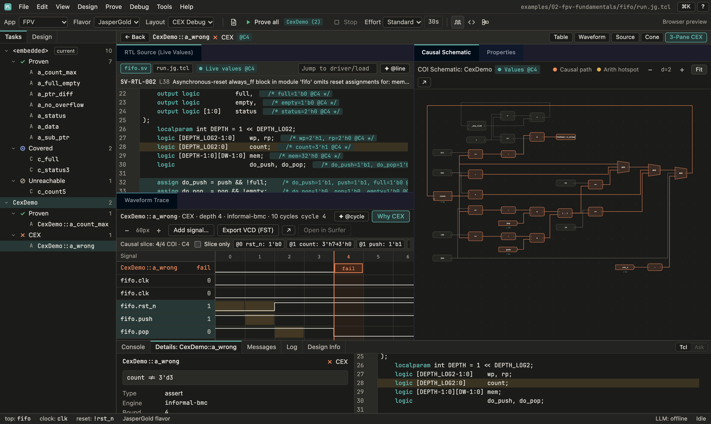
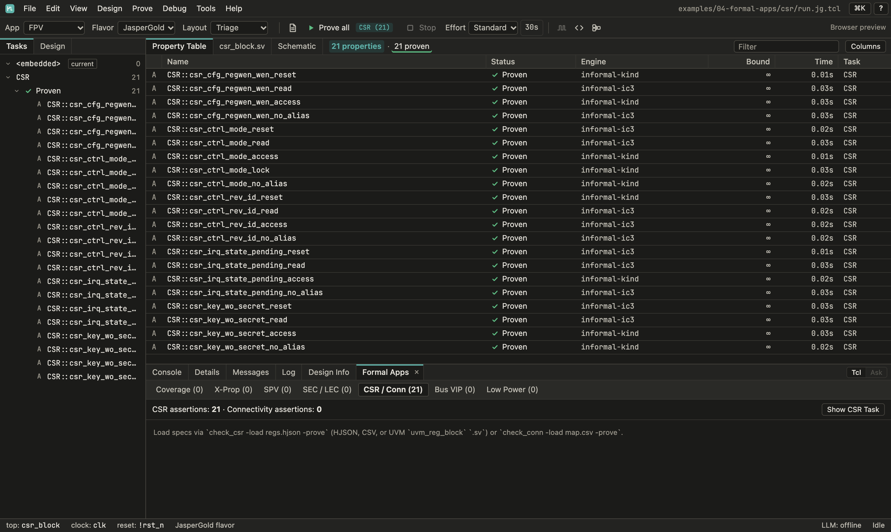

# InFormal

InFormal is an open-source formal property verification (FPV) tool for digital designs, written in Rust and released under the Apache-2.0 license. It compiles IEEE 1800-2023 SystemVerilog and SVA through [svlang](https://github.com/mayurkubavat/svlang) without silent synthesis fallbacks, runs a multi-paradigm checked engine portfolio (bit-level and word-level), ships **eight built-in Formal Apps** (including IEEE 1801 UPF low-power checking), executes JasperGold and VC Formal Tcl scripts natively, includes a Tauri 2 + React desktop workbench, and exposes a verifier-gated Model Context Protocol (MCP) interface for AI verification workflows.

**Status: pre-release (0.1).** Core FPV, all eight Formal Apps, independent proof certificates, desktop workbench, and the AI MCP interface are tested end-to-end, while SystemVerilog/SVA coverage continues to expand. For sign-off flows, validate verdicts with `--certificate` (Certifaiger + `aigsim`).



<table>
  <tr>
    <td width="50%">
      
      <p align="center"><sub><strong>FPV Triage &amp; Multi-Task Proofs (Light Theme)</strong> — JasperGold/VCF property table, invariant clause evidence, and temporal SVA source.</sub></p>
    </td>
    <td width="50%">
      
      <p align="center"><sub><strong>Eight Built-In Formal Apps (Dark Theme)</strong> — Auto-synthesized CSR/RAL proofs alongside Coverage/UNR, X-Prop, SPV, SEC/LEC, Bus VIP, and Low Power (UPF).</sub></p>
    </td>
  </tr>
</table>

## Capabilities

- **Fail-closed IEEE 1800-2023 SystemVerilog & SVA front end.** Powered by [`svlang`](https://github.com/mayurkubavat/svlang), lowering RTL, `bind`, Clause 17 `checker`, and concurrent/immediate SVA (bounded & unbounded delays/repetitions via Glushkov NFA / ROBDD-DFA, `accept_on`/`reject_on`, local variables, SVA `case`, `$past`/`$rose`/`$fell`, liveness `s_eventually`/`s_until` via Miyano–Hayashi breakpoints) to per-task word-level Btor2 with explicit refusal diagnostics and `SVA-FPV-001..005` formal-readiness lint ([SVA Reference](docs/reference/sva-support.md)).
- **Multi-paradigm checked engine portfolio.** Composable AIG passes (`rewrite`, `fraig`, `scorr`, temporal decomposition, period-2 clock folding) feed a parallel native solver suite with **Phase 2 `LemmaHub`** cooperative proof sharing and **Phase 3 learned Ridge staged-wave scheduling**:
  - *Bit-level:* BMC (`informal-bmc`, `-bmc-10`, `-bmc-65`), $k$-induction (`informal-kind`), IC3/PDR (`informal-ic3`, `-ic3-mt`, `-ic3-inn`, GLA-CEGAR `informal-gla`), IC3-fed $k$-induction (`informal-kind-ic3`), native Craig interpolation (`informal-imc` with CaDiCaL proof tracing), Forward & Backward CAR (`informal-car`), pure-Rust complemented-edge ROBDD (`informal-bdd`), liveness (`informal-klive` + SCC-guided `informal-rlive`), and bit-parallel simulation-guided swarm bug hunting (`informal-swarm`).
  - *Word-level:* Bitwuzla BMC (`informal-wbmc`), word-level $k$-induction (`informal-wkind`), and word-level `IC3SA` with prophecy over unblasted `Sort::Array` memories.
  - *Checked verdicts & certificates:* Every bit-level invariant and counterexample is re-checked on a fresh encoding of the un-preprocessed loaded model; 3-step vacuity and minimal conflicting-assumption core checks run by default; `--certificate` exports witness circuits and traces validated independently by Certifaiger and `aigsim` ([Certificates & Signoff](docs/guide/certificates-and-signoff.md)). External engines (rIC3, ABC, Pono, BtorMC) plug in via [`config/engines.toml`](config/engines.toml).
- **Eight built-in Formal Apps.**
  - `check_cov` — COI observability & branch/toggle UNR with waivers and HTML reports
  - `check_conn` — OpenTitan/JasperGold CSV pin-to-pin, muxed, and pipelined connectivity
  - `check_xprop` — Exact 2-copy self-composition X-propagation (zero mux X-pessimism)
  - `check_spv` — 2-safety non-interference security path verification
  - `check_sec` — Sequential, pipelined (`-latency N`), and combinational (`-lec`) equivalence
  - `check_csr` — Auto-generated register verification from OpenTitan HJSON, CSV, or UVM RAL `.sv`
  - `check_protocol` — One-command APB4, AXI4-Lite, and TileLink-UL bus VIP
  - `check_lp` / `load_upf` — IEEE 1801 UPF + Liberty low-power static PG checks, formal 2-copy corruption, and LP-SEC equivalence ([Formal Apps Guide](docs/guide/formal-apps.md))
- **JasperGold & VC Formal Tcl shell.** `informal shell` embeds Tcl 8.6 with **85 commands** across `jg`, `vcf`, and `common` flavors — non-blocking REPL, interactive `help <cmd>`, `shell --check` migration linting, task isolation, `stopat` cut points, `abstract -counter`, and SHA-256 proof caching ([Tcl Command Reference](docs/reference/tcl-commands.md)).
- **Causal root-cause & complexity debug.** Dynamic backward causal CEX slicing (`why_cex`), streamed FST/VCD waveforms, COI complexity profiling (`get_fv_complexity`), `blackbox_assistant`, `check_fv_setup`, `informal reduce` delta debugging, and `informal split` ([Debugging CEX Guide](docs/guide/debugging-cex.md)).
- **Desktop workbench & verifier-gated AI interface.** Tauri 2 + React desktop app (`ui/`) with 4 workspace presets, synchronized HiDPI `<canvas>` waveforms, CodeMirror 6 RTL with `@C<k>` live trace annotations, ELK.js causal schematics, Command Palette (`Cmd/Ctrl+K`), Proposals review, and Ask mode; `informal mcp` exposes **52 JSON-Schema tools** (including `cex_diagnose`, `convergence_diagnose`, zero-side-effect 2QBF CEGIS `proposal_validate`, `lp_diagnose`, `spec_audit`, and live `gui_*` control via `informal mcp --connect`), **5 live-hydrated MCP prompts**, an embedded MCP App workbench, and an Antigravity plugin (`plugin/`) ([AI & MCP Guide](docs/integration/ai-and-mcp.md)).

## Open-Source Verification Ecosystem

InFormal is part of a modular pure-Rust hardware verification stack built around `svlang`:

- **[svlang](https://github.com/mayurkubavat/svlang)** — Pure-Rust IEEE 1800-2023 SystemVerilog compiler SDK (`crates.io` / `PyPI`), 475-rule static linter, and Language Server ([Research Square preprint](https://doi.org/10.21203/rs.3.rs-11813840/v1)).
- **[svcc](https://github.com/mayurkubavat/svcc)** — Translation validation of SystemVerilog-to-SystemC RTL conversion ([arXiv:2611.31674](https://arxiv.org/abs/2611.31674)).
- **[systemc-lp](https://github.com/mayurkubavat/systemc-lp)** — IEEE 1801 UPF power-aware simulation and formal equivalence for unmodified SystemC and SystemVerilog RTL using InFormal and Certifaiger.

## Documentation & Hands-On Labs

The complete manual set lives in **[docs/README.md](docs/README.md)** (also indexed for AI agents in **[llms.txt](llms.txt)**):

| Book | Entry Point | What You'll Find |
| --- | --- | --- |
| **User Guide** | [docs/guide/getting-started.md](docs/guide/getting-started.md) | Installation, FPV methodology, CEX debugging, convergence & engines, 8 Formal Apps, certificates, desktop UI |
| **Tool Integration** | [docs/integration/vendor-migration.md](docs/integration/vendor-migration.md) | JasperGold/VC Formal migration (`--check`), CI/batch recipes, engine/LLM config, MCP & AI agents |
| **Command Reference** | [docs/reference/cli.md](docs/reference/cli.md) | Auto-generated CLI, Tcl (85 commands), JG↔VCF crosswalk, SVA support, MCP (52 tools / 5 prompts), `fvp.spec.json` |
| **Hands-On Labs** | [examples/README.md](examples/README.md) | Runnable, gate-tested designs from first counter proof to Formal Apps and `spec_audit` signoff |

## Quick Start

Tested on Ubuntu 24.04/26.04 (x86-64) and macOS (Apple Silicon). See [Getting Started](docs/guide/getting-started.md) for optional solvers (`Bitwuzla`, `rIC3`, `ABC`) and full platform notes. On Ubuntu/Debian, `scripts/bootstrap.sh --apt` automates prerequisites.

1. **Install prerequisites** ([rustup](https://rustup.rs), C++ compiler, Tcl 8.6):

   ```sh
   sudo apt install build-essential tcl8.6-dev      # Ubuntu / Debian
   brew install tcl-tk@8                            # macOS
   ```

2. **Build CaDiCaL** (SAT solver used by bit-level engines):

   ```sh
   export INFORMAL_TOOLS_DIR=$HOME/informal-tools
   mkdir -p "$INFORMAL_TOOLS_DIR" && cd "$INFORMAL_TOOLS_DIR"
   git clone https://github.com/arminbiere/cadical && cd cadical
   git checkout rel-3.0.1 && ./configure -fPIC && make -j4
   ```

3. **Build InFormal and run the Quickstart lab:**

   ```sh
   git clone https://github.com/mayurkubavat/informal && cd informal
   cargo build --release
   target/release/informal shell examples/01-quickstart/counter/run.jg.tcl
   ```

   Expected summary (engines and times vary):

   ```text
   property                     type    status        engine            detail
   a_max                        assert  proven        informal-kind     0.06 s
   a_step                       assert  proven        informal-kind     0.10 s
   a_hold                       assert  proven        informal-kind     0.08 s
   a_never9                     assert  cex           informal-bmc      depth 10 in 0.06 s
   a_no_wrap                    assert  proven        informal-kind-ic3 0.04 s
   c_done                       cover   covered       informal-bmc      depth 10 in 0.07 s
   c_10                         cover   unreachable   informal-kind-ic3 0.06 s
   ```

Run commands from the repository root so `informal` locates `config/engines.toml` (or pass `--engines <path>`). Inside `informal shell`, type `help`, `help -apps`, or `help <command>` at any time.

## Common Workflows

```sh
# Run an FPV script (flavor auto-detected) or open an interactive Tcl shell
target/release/informal shell examples/02-fpv-fundamentals/fifo/run.jg.tcl
target/release/informal shell --flavor vcf

# Audit a JasperGold / VC Formal script before migrating (no elaboration or prove)
target/release/informal shell --check path/to/setup.tcl

# Serve an FPV session to an AI agent, or attach live to InFormal.app
target/release/informal mcp --mode propose --root path/to/project
target/release/informal mcp --connect

# Prove a standalone Btor2/AIGER model with independent Certifaiger/aigsim certificates
target/release/informal check tests/models/delay_safe.aag --certificate certs/
python3 -I scripts/certificate_check.py certs/

# Lower SystemVerilog to Btor2 or verify auto-generated reference manuals
target/release/informal lower examples/01-quickstart/counter/counter.sv --top counter
target/release/informal docgen --check
```

The desktop app is built separately in `ui/`; see [Desktop Workbench Guide](docs/guide/workbench-ui.md) and [`ui/README.md`](ui/README.md).

## Benchmarks

Development is tracked on the 319 bit-level safety models of HWMCC'24 (Zenodo record 14775242; models not checked into git) and a 167-design / 936-property SystemVerilog comparison suite against SymbiYosys and EBMC (`bench/compare/`):

- **HWMCC'24 core portfolio (300 s/model, 16-core 26 GB Linux host):** **202 / 319** solved with period-2 clock folding (`191 / 319` pre-folding baseline; **204 / 319** virtual-best across per-engine runs) with **0 contradicting verdicts** against published answers.
- **External certificate confirmation:** Certifaiger and `aigsim` confirmed **183 / 188** in-house HWMCC'24 verdicts (**97.3%**, **0 rejected**), including two-step parity-latch witness circuits for clock-folded proofs.
- **End-to-end SystemVerilog flow comparison (167 designs, 936 properties):** **162 / 167** designs read (`97.0%`), **782** definite verdicts, and **599 / 602** (`99.5%`) pairwise agreement (`467 / 467`, `100%` with SymbiYosys).

See [`bench/README.md`](bench/README.md) and [`bench/compare/README.md`](bench/compare/README.md) to reproduce.

## Repository Layout

| Path | Role |
| --- | --- |
| `crates/` | 29-crate Rust workspace: front end (`informal-{svlang,ir,aig,upf,liberty}`), solvers & engines (`informal-{sat,bmc,ic3,imc,car,bdd,liveness,swarm,bitwuzla,engine,engines-ext}`), FPV & Formal Apps (`informal-{session,fpv,tcl,compat,trace,debug,app-conn,app-csr,app-protocol}`), AI & CLI (`informal-{mcp,llm,cli,bench}`) |
| `ui/` | Tauri 2 + React desktop workbench and embedded MCP App bundle |
| `plugin/` | Antigravity plugin manifest, MCP launcher, and progressive-disclosure FPV skills |
| `config/` | External engine definitions (`engines.toml`) and Ask-mode LLM providers (`llm.toml`) |
| `docs/` | Four-book EDA documentation portal (`guide/`, `integration/`, `reference/`, `labs/`) and design notes |
| `examples/` | Runnable, gate-tested FPV & Formal Apps lab curriculum (`01-quickstart` through `05-integration-and-signoff`) |
| `tests/` | Automated Rust/SV/Btor2/AIGER test fixtures |
| `scripts/` | Pre-merge gate (`check.sh`), hygiene, doc/example verification, and benchmark drivers |

Local working data (`bench/hwmcc24/`, `bench/runs*.jsonl`, `informal_work/`, `research/`, `docs/review/`) is git-ignored and enforced by [`scripts/hygiene.sh`](scripts/hygiene.sh).

## Build, Test, and Quality Gate

```sh
cargo build --release
cargo test
scripts/check.sh        # hygiene, fmt, clippy, Rust/UI tests, docgen sync, link & example checks
```

`scripts/check.sh` ends with `GATE: PASS` or `GATE: FAIL (<step>)`. Pass `--fast` while iterating, `--e2e` to include Playwright UI tests, `--quiet` to throttle parallelism on a busy machine, or `--allow-missing-tools` when optional external solvers are absent. On macOS, set `CARGO_BUILD_JOBS=2` when building the full workspace.

## Citation

If you use InFormal in academic research, benchmarks, or verification flows, please cite (also available via GitHub's **Cite this repository** button from [`CITATION.cff`](CITATION.cff)):

```bibtex
@misc{kubavat2026informal,
  author       = {Mayur Kubavat},
  title        = {{InFormal}: An Open-Source Formal Property Verifier for {SystemVerilog} with Checked Verdicts},
  howpublished = {Tech.\ Rep., Nov.\ 2026, doi: 10.5281/zenodo.24261270},
  year         = {2026},
  url          = {https://github.com/mayurkubavat/informal}
}
```

## License & Third-Party Tools

Apache-2.0 (`LICENSE`, `NOTICE`). Third-party solver versions, licenses, and build steps are documented in [`docs/third-party.md`](docs/third-party.md) and pinned in [`tools.lock`](tools.lock). See [`CONTRIBUTING.md`](CONTRIBUTING.md) before opening a pull request.
