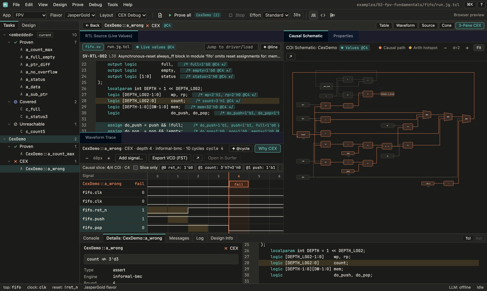
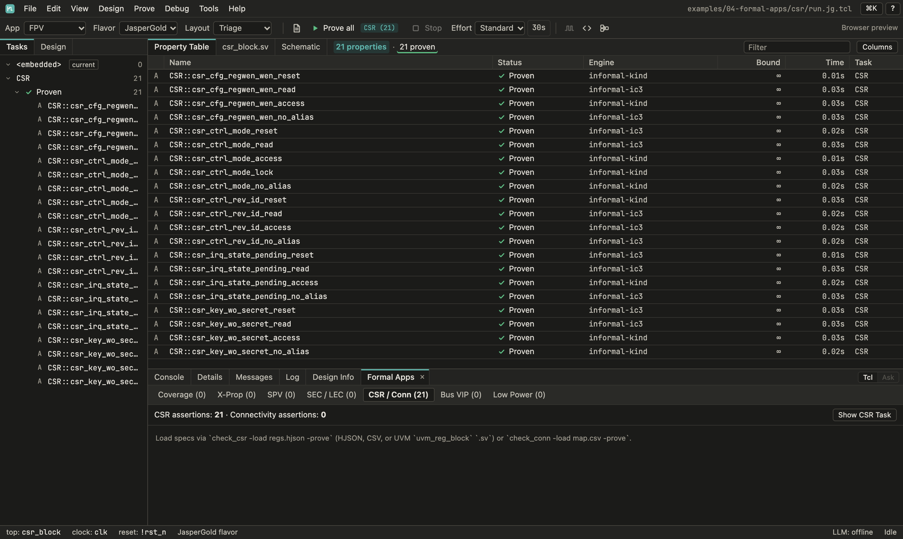

# Desktop Workbench UI (`InFormal.app`)

InFormal includes a cross-platform desktop workbench built with Tauri 2 and React (`ui/`), designed around standard EDA formal verification workflows — synchronized property tables, CodeMirror 6 RTL source overlays with inline `@C<k>` values, ELK.js COI & causal schematics, streamed HiDPI `<canvas>` waveforms (VCD/FST), eight built-in Formal Apps, AI proposal review, Command Palette (`Cmd/Ctrl+K`), and local LLM Ask mode.



---

## 1. Building & Running the Workbench

```sh
cd ui
npm ci

# Live development mode
npm run tauri dev

# Production macOS / Linux app bundle (keep CARGO_BUILD_JOBS=2 on macOS)
CARGO_BUILD_JOBS=2 npx tauri build --bundles app
```

See [`ui/README.md`](https://github.com/mayurkubavat/informal/blob/main/ui/README.md) for frontend tests (`npm test`) and Playwright E2E/UX tests (`npm run test:e2e`).

---

## 2. Workspace Presets & Panels

The workbench uses a dockable graphite/teal multi-pane layout (Light, Dark, and System themes) with four presets optimized for each stage of formal verification:

| Preset | Purpose | Key Panels |
| --- | --- | --- |
| **Triage** | Initial script load, elaboration, design stats, lint | Tasks/Design sidebar, Property Table, Design Info, Tcl Console, Messages |
| **CEX Debug** | Deep counterexample & witness analysis | Synchronized RTL SourceView (with inline `@C<k>` values + `.sv`/`.tcl` switcher), SchematicView (ELK.js COI + active `why_cex` paths), TraceView (HiDPI `<canvas>` waveform + `Why CEX` causal filter + FST/VCD export + Surfer launch), compact Details dock |
| **Split** | Side-by-side table & RTL/trace authoring | Property Table paired directly with live SourceView or TraceView |
| **Signoff & Formal Apps** | Running & reviewing Formal Apps, vacuity, covers, and proposals | Dedicated Formal Apps dock (`Coverage`, `X-Prop`, `SPV`, `SEC / LEC`, `CSR / Conn`, `Bus VIP`, `Low Power`), Property Table, Details/Stats, Proposals |



### Cross-Probing, Keyboard Contracts & Quick-Fix

- **Property → Source / Trace / Schematic:** Selecting any property updates the Details inspector (including invariant clause counts and proof evidence), jumps SourceView to the RTL or Tcl definition, and enables waveform + schematic inspection for `cex`/`covered` properties.
- **Inline Signal Values (`@C<k>`):** Moving the waveform cursor updates inline signal value annotations in SourceView and node labels in SchematicView.
- **Formal Lint & Quick-Fix:** `SVA-FPV` and `SV-RTL` lint diagnostics appear inline in SourceView with 1-click `Quick-Fix` buttons.
- **Zero-Mouse Navigation:** Open the Command Palette (`Cmd/Ctrl+K`) or Shortcut Sheet (`?`) to switch presets, themes, effort levels, and Formal Apps without leaving the keyboard.

---

## 3. AI Proposals & Live Agent Co-Working

Every running `InFormal.app` instance serves its active session on a private Unix socket (`$XDG_RUNTIME_DIR/informal/app-<pid>.sock`, or `INFORMAL_AI_SOCKET`). Connect any MCP client live with:

```sh
informal mcp --connect
```

- **Human-in-the-loop Proposals:** In default `propose` mode, agent-proposed assumptions, assertions, covers, cut points, and Tcl commands appear as cards in the **Proposals** tab with rationale, **Accept**, and **Reject** controls. Accepted edits are tagged **AI**, and any proof relying on them displays **`under AI`**.
- **Guided Visual Walkthroughs:** Agents can call `gui_present_cex` or `gui_present_walkthrough` to switch into `CEX Debug`, pin causal callouts onto the waveform, and step you through a multi-cycle failure via the top Walkthrough Bar.

---

## 4. Built-In Ask Mode (Local or Remote LLM)

The console includes an **Ask** mode backed by `informal-llm` and configured in [`config/llm.toml`](../../config/llm.toml) (defaulting to local Gemma on Ollama, or OpenAI-compatible / Anthropic APIs). Ask mode is strictly read-only and has direct access to `cex_diagnose`, `convergence_diagnose`, `property_get`, `why_cex`, and `design_source`. See [docs/ui/ask-mode.md](../ui/ask-mode.md) for provider configuration.

---

## Related Guides

- [Debugging Counterexamples](debugging-cex.md)
- [Formal Apps Guide](formal-apps.md)
- [AI & MCP Integration](../integration/ai-and-mcp.md)
- UI internals: [stop-progress.md](../ui/stop-progress.md) · [trace-format.md](../ui/trace-format.md) · [testing.md](../ui/testing.md)
